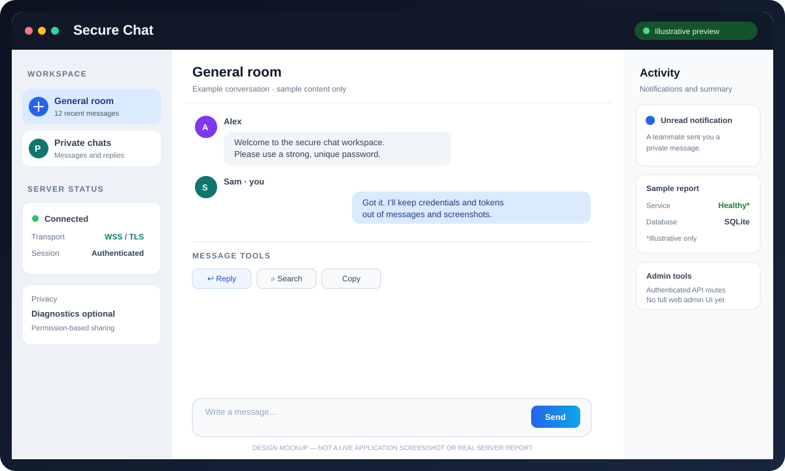
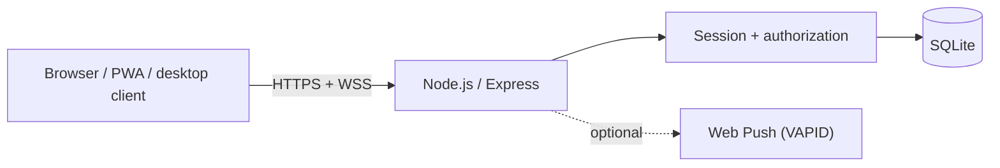

# Secure Chat System

<p align="center">
  
</p>

<p align="center"><strong>Self-hosted, cross-platform text chat for Windows, Linux, and mobile browsers.</strong></p>

 > **Preview note:** The image above is a design mockup for documentation, not a screenshot of a running deployment. The web client now includes a basic administrator user inventory with account-disable controls; audit events and notification history remain available through authenticated API routes.

## Features

- Node.js + Express HTTPS API, WSS chat, and SQLite persistence.
- Responsive browser client / installable PWA; Electron desktop manager and chat window.
- Account registration/login, server-side sessions and private-message authorization.
- Message history, quoted replies, search of currently loaded messages, copy, and per-account/per-conversation local drafts.
- Unread notifications and administrator announcements to one enabled user or all enabled users.
- Optional browser Web Push using VAPID keys.
- Administrator user inventory, account status, and account-disable/session-revocation controls. The default web client does not offer device-diagnostics or location-sharing controls.
- Security headers, bounded payloads, input validation, and basic in-process request/message throttling.
- Windows installer; Linux AppImage and Debian package build targets.

## Architecture

See [Architecture, data flow, and trust boundaries](docs/ARCHITECTURE.md) for Mermaid diagrams and a security-boundary explanation.



## How to install

### Option A — Desktop app (recommended for non-technical users)

1. Open the repository's [Releases page](https://github.com/ahsanibnewalid/secure-chat-system-with-server/releases).
2. Download the installer for your operating system if a release is available:
   - **Windows:** `Secure-Chat-Setup-<version>.exe`
   - **Linux:** `Secure-Chat-<version>.AppImage` or `.deb`
3. Install/open **Secure Chat**. In the desktop manager, choose **Start server**, then **Open local chat**.
4. Use the server settings to change the port or enable LAN mode only when you understand the network and TLS implications.

If no release artifact is published yet, use Option B to run from source or build the desktop package. Builds may be unsigned and trigger operating-system warnings.

### Option B — Run from source (Windows or Linux)

**Requirements:** Node.js 22+ (matching `package.json`), npm, and OpenSSL for the development certificate.

1. Clone and enter the project:

   ```sh
   git clone https://github.com/ahsanibnewalid/secure-chat-system-with-server.git
   cd secure-chat-system-with-server
   npm install
   ```

2. Follow the certificate and environment setup in [docs/SETUP.md](docs/SETUP.md). Create a development TLS certificate, copy `.env.example` to `.env`, and configure the key/certificate paths and a strong one-time admin bootstrap token. Do not commit `.env`, private keys, database files, or real user data.
3. Start the server:

   ```sh
   node --env-file=.env src/server.js
   ```

4. Open the configured HTTPS URL, typically `https://127.0.0.1:8443`, using a browser that trusts the certificate. A self-signed development certificate may show a warning and is not automatically trusted by phones.
5. Create the first administrator by following the **Create the first administrator** section in [docs/SETUP.md](docs/SETUP.md). Remove `ADMIN_BOOTSTRAP_TOKEN` from the environment and restart immediately after successful bootstrap.

Windows PowerShell supports the same Node command. Keep the host bound to localhost during initial setup. For LAN or internet access, use a trusted certificate for the hostname clients will visit and configure the firewall deliberately.

### Verify the checkout

```sh
npm run check
npm test
```

To build the desktop package on the operating system you are building for:

```sh
npm run dist
```

Build artifacts are written to `release/`. See [Desktop apps and builds](docs/DESKTOP-APPS.md).

## Screenshots and operational reports

- **Interface preview:** [open the illustrative SVG](docs/assets/dashboard-preview.svg). It shows the intended chat layout and example activity panel; it is not a live screenshot or real metrics.
- **Architecture diagrams:** [docs/ARCHITECTURE.md](docs/ARCHITECTURE.md).
- **Live health output:** request `GET /api/v1/health` from the configured server URL.
- **Admin metrics:** `GET /api/v1/admin/metrics`.
- **Admin user inventory:** `GET /api/v1/admin/users`.
- **Audit events:** `GET /api/v1/admin/audit`.
- **Admin notification history:** `GET /api/v1/admin/notifications`.

The repository does not currently ship captured screenshots of a live production dashboard. To document a real deployment, run the app locally, capture the actual UI and sanitized API output, and replace/add images without exposing usernames, IP addresses, session tokens, notification contents, or other private data.

## Security model and limitations

- TLS 1.2+ is required; the server refuses to start without a certificate and private key.
- Passwords use Node.js scrypt with per-account random salts. Session tokens are random bearer tokens stored as SHA-256 hashes.
- Server-side authorization protects private history and administrator routes. Request bodies and messages have size limits; message text is rendered as text, not HTML.
- The server can read stored message content. **This is not end-to-end encryption.**
- Rate limiting is in-process and is not a substitute for a reverse proxy/WAF, distributed throttling, or DDoS protection.
- The default web client does not submit device diagnostics or location. The server retains an API for authorized lab integrations; use it only with clearly scoped, enrolled test clients. Browser-reported device properties can be spoofed.
- Web Push is browser/PWA-only where supported; native APNs/FCM integration is not included.
- No independent penetration test or formal security certification is claimed.

For security setup, backup/recovery, privacy, and troubleshooting, read [docs/SETUP.md](docs/SETUP.md), [docs/THREAT-MODEL.md](docs/THREAT-MODEL.md), and [docs/SECURITY-OPERATIONS.md](docs/SECURITY-OPERATIONS.md).

## Project status

This is a functional self-hosted text-chat foundation, not a claim of a finished enterprise messaging platform. The guided admin-bootstrap wizard, full web admin dashboard, automatic public TLS provisioning, OS service installer, auto-updates, signed release binaries, and native Android/iOS apps are not yet included.

## Documentation

- [Architecture and data flow](docs/ARCHITECTURE.md)
- [Setup and troubleshooting](docs/SETUP.md)
- [Desktop executable guide](docs/DESKTOP-APPS.md)
- [Threat model](docs/THREAT-MODEL.md)
- [Security operations](docs/SECURITY-OPERATIONS.md)
- [Roadmap](docs/ROADMAP.md)
