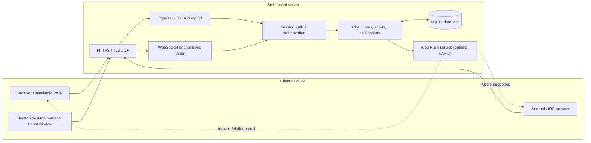
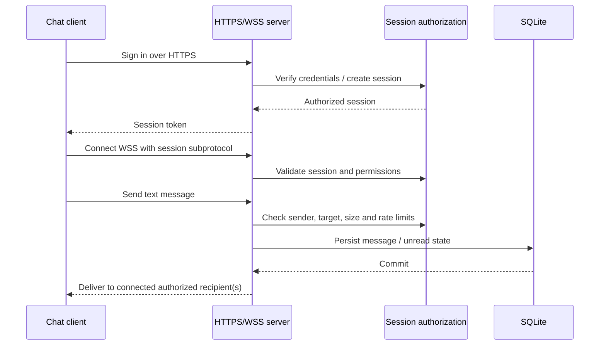

# Architecture and data flow

Secure Chat is a self-hosted text messaging system. The browser/PWA and desktop chat window are clients; the Node.js service owns authentication, authorization, WebSocket messaging, notifications, and SQLite persistence.

## High-level architecture

## Message flow

## Trust boundaries and storage

- **Client:** browser UI, local draft storage, optional permission-based device diagnostics. Treat all client-supplied values as untrusted.
- **Transport:** HTTPS/WSS protects traffic in transit. Use a hostname and certificate trusted by every connecting device.
- **Application:** server-side session validation, private-message authorization, input/size limits, and admin-route checks.
- **Persistence:** SQLite stores accounts, password hashes, sessions/related state, messages, audit/notification and opted-in device records as implemented by the current schema. Protect the data directory and backups with OS permissions.
- **Optional push:** Web Push requires HTTPS, explicit browser permission, and server-side VAPID keys. It is not native APNs/FCM.
- **Admin bootstrap:** a one-time secret creates the initial administrator; remove it from the environment and restart after use.

## Security boundaries (important)

This is not end-to-end encrypted: the server processes message content. TLS does not protect a compromised endpoint or server. A self-signed development certificate is not automatically trusted by phones. Do not expose a development instance to the public internet without a trusted certificate, firewalling, monitoring, backup/recovery procedures, and appropriate edge rate limiting.

## Operational health and reports

- Health endpoint: `GET /api/v1/health` (process and database reachability).
- Admin metrics: `GET /api/v1/admin/metrics`.
- Admin user inventory: `GET /api/v1/admin/users`.
- Admin audit events: `GET /api/v1/admin/audit`.
- Admin notification history: `GET /api/v1/admin/notifications`.

The repository includes a dashboard preview image in the README for orientation. It is an **illustrative mockup**, not a captured live session or a claim that a complete web admin dashboard exists. The current admin functionality is exposed through authenticated API routes; full web admin screens are not yet implemented.
